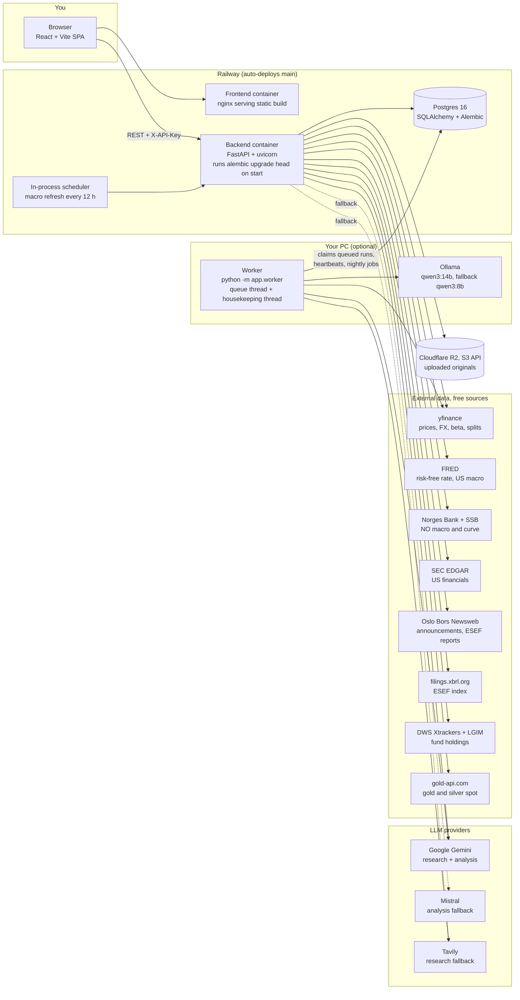
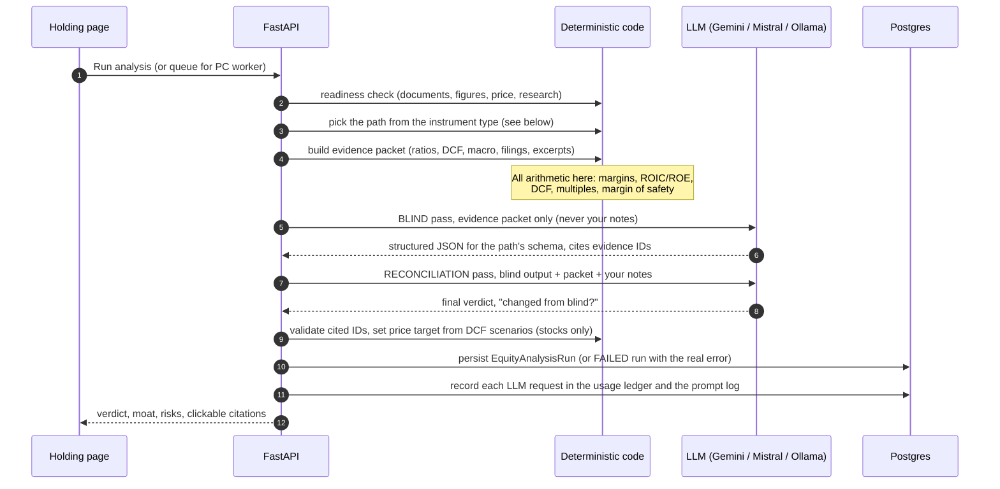
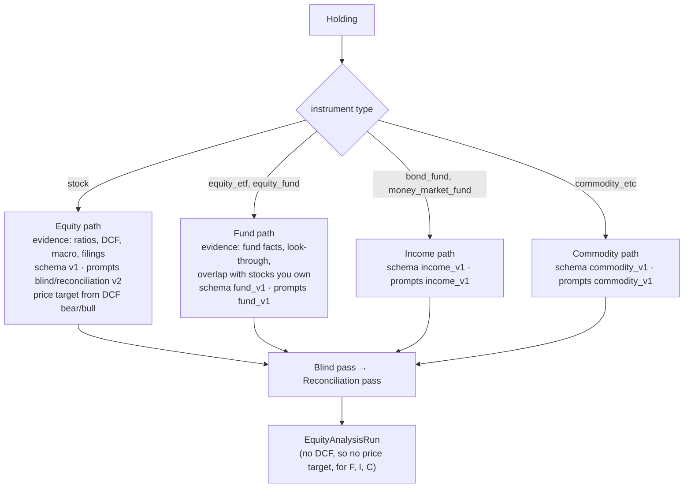
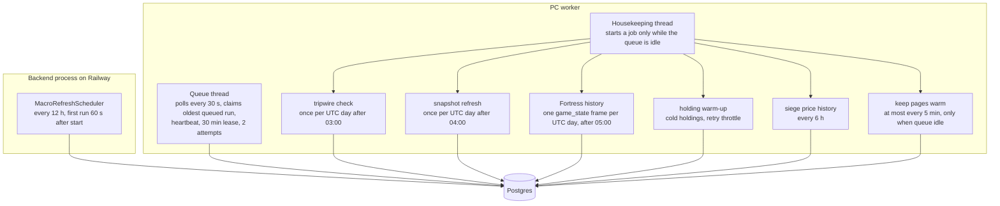
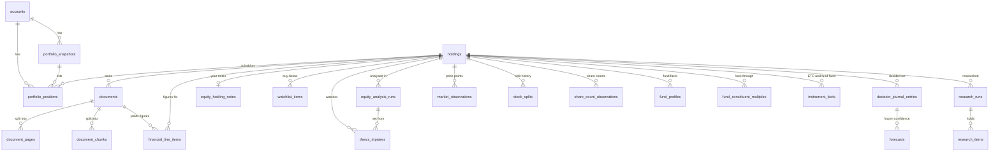
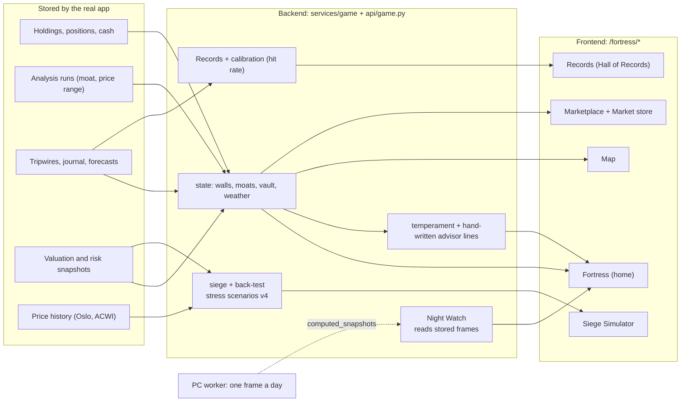
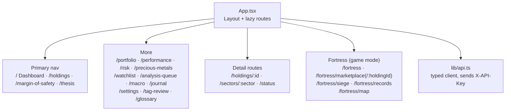

# Aladdin: architecture

*Rewritten 2026-10-19 from the code on `main` (`4d0ce8b`, PR #185). Update it in the same change whenever a
service, provider, scheduled job, table or deployment piece is added or removed. Counts below (routes,
routers, tables) were taken from the code that day; the "How this was checked" note at the end says how
to re-take them.*

Aladdin is a personal, single-user equity analysis app in the Buffett/Munger style. **Deterministic
Python code computes every number; an LLM only researches and writes judgement, and every claim it
makes must cite an evidence ID.** The five non-negotiable rules are in [`CLAUDE.md`](../CLAUDE.md).

Contents: [1 System diagram](#1-system-diagram) · [2 Analysis run](#2-one-analysis-run-end-to-end) ·
[3 Backend layers](#3-backend-layers) · [4 Deployment](#4-deployment-and-runtime) ·
[5 Background jobs](#5-background-jobs) · [6 Data model](#6-data-model) ·
[7 Game mode](#7-game-mode-fortress) · [8 Guardrails](#8-where-each-guardrail-is-enforced) ·
[9 Frontend](#9-frontend) · [10 CI and tooling](#10-ci-and-tooling) · [11 Known gaps](#11-known-gaps-and-loose-ends)

---

## 1. System diagram



The PC worker talks **only to the database and outbound APIs**. It opens no port and accepts no
input (CLAUDE.md rule 5). Railway cannot reach Ollama, so an analysis started from the Railway site
either runs on Gemini/Mistral, or is queued for the worker ("Run on my PC").

**Hosting changed since the first version of this diagram.** Supabase is retired for Aladdin (Faiz's
decision, 2026-10-14): the database is Railway Postgres and the uploaded originals are on Cloudflare R2
(`OBJECT_STORAGE_PROVIDER=r2`). The code still *accepts* `supabase` as a storage provider name and
`backend/.env.example` still shows Supabase connection strings as an example; those are leftovers, not
the live setup. The cut-over is described in
`supabase-to-railway-postgres-runbook-2026-10-09.md` (see [section 11](#11-known-gaps-and-loose-ends)).
This pass did not re-check the live Railway services.

---

## 2. One analysis run, end to end



### Four analysis paths, chosen by instrument type

`Holding.asset_class_raw` carries the instrument type (`domain/instrument_types.py`). The pipeline
(`services/analysis/pipeline.py`) branches on it:



Failure handling: a blind-pass failure stores a FAILED run with the real error; a reconciliation
failure keeps the blind output and records the second error separately. If the primary provider is
out of quota and `LLM_FALLBACK_PROVIDER` is set, the call falls back (`_call_with_fallback`). Prompts
(`backend/prompts/analysis/`) and schemas (`app/domain/analysis_schema/`) are versioned files; a change
that could alter a real output is a new version file. The active versions are in
`config/settings.py` (`ACTIVE_*_VERSION`).

---

## 3. Backend layers

```
backend/app/
  main.py        FastAPI app, middleware, router registration, lifespan (starts the macro scheduler)
  security.py    ApiKeyMiddleware: X-API-Key must equal APP_AUTH_TOKEN (only /health is exempt)
  timing.py      Server-Timing / X-DB-Queries headers on every response
  api/           21 routers, 127 routes, thin: validate, call a service, shape the response
  services/      business logic (the only place that orchestrates providers + DB)
  providers/     adapters for every outside system, behind interfaces in providers/base.py
  domain/        pure, versioned definitions: schemas, assumptions, series catalogue, sectors, game mapping
  models/        SQLAlchemy tables
  schemas/       Pydantic request/response models
  worker/        the PC worker loop
  config/        Settings (env-driven), database session
```

About 47,000 lines of Python in `app/`; 160 test files holding about 1,670 test functions.

### API routers

| Router (prefix) | Routes | Serves |
|---|---:|---|
| `holdings` (`/holdings`) | 14 | Holdings CRUD, field options, periods, metrics, warm-up, share-count override, delete (needs `confirm`) |
| `accounts` (`/accounts`), `portfolio` (`/portfolio`) | 5 + 6 | Accounts and cash; CSV import, snapshots, overview, deletes |
| `documents` (`/documents`) | 5 | Uploads, stored-file streaming (`/documents/{id}/file`), delete |
| `sources` (`/sources`) | 11 | ESEF index, SEC EDGAR, Newsweb announcements, annual and interim report fetch and import |
| `research` (`/research`) | 6 | Macro, sector and company research (cached 24 h, served stale rather than blocking) |
| `valuation` (`/valuation`) | 4 | Holding valuation, Margin-of-safety board, refreshes |
| `analysis` (`/analysis`) | 9 | Readiness, run, queue, cancel, latest run, notes |
| `thesis` (`/thesis`) | 8 | Tripwires, monitor, metric registry, nightly check trigger |
| `risk` (`/risk`), `performance` (`/performance`) | 2 + 2 | Correlation, clusters, stress, regime; value history, benchmark, real return |
| `funds` (`/funds`) | 10 | Fund facts and profile, returns, exposures, look-through; Xtrackers and LGIM fetch |
| `macro` (`/macro`), `precious_metals` (`/precious-metals`) | 2 + 7 | Macro series; physical coins at spot |
| `watchlist`, `journal` | 6 + 5 | Buy-below list; decision journal with "then and now" |
| `tag_review` (`/tag-review`) | 7 | Suggested ESEF tag mappings: accept, reject, export, re-extract |
| `system`, `usage`, `settings` | 4 + 1 + 2 | Status page, holding-currency check, LLM prompt log, LLM usage ledger, demo-mode toggle |
| `game` (`/game`) | 11 | See [section 7](#7-game-mode-fortress) |

### Services (by area)

| Area | What it does |
|---|---|
| `calculations`, `metrics`, `valuation/` | Ratios, owner earnings, ROIC/ROE, DCF with growth cap and fade, bank price-to-book path, plausibility guard, discount rate, "what the price assumes" for loss-making companies, regime adjustment (off by default) |
| `documents/`, `filings/` | Ingestion (ESEF inline XBRL, PDF text, Excel, CSV), section-aware chunking, anchoring figures to exact numbers, SEC EDGAR, Newsweb, ESEF index |
| `tag_review`, `tag_rules`, `tag_export` | Inbox of ESEF tag gaps and the mapping rules you accept or reject |
| `analysis/` | Readiness, evidence packet and its token budget, document excerpts, blind and reconciliation passes, queue, pipeline, target check |
| `instruments/`, `funds/` | Instrument facts and metrics for funds, bond funds and ETCs; fund facts, holdings import, look-through, constituent multiples |
| `research/`, `macro/`, `market_data/` | Research with cache, macro series and refresh, price / FX / beta / shares / splits / risk-free rate, currency and sanity checks |
| `risk/`, `performance/`, `thesis/` | Correlation, stress, regime, price history; portfolio history; tripwires, timeline and nightly check |
| `precious_metals/`, `portfolio_import/` | Coins at spot; broker CSV (Nordnet) |
| `snapshots`, `snapshot_refresh`, `warmup` | Stored page snapshots so slow pages load from the database; the nightly rebuild, the keep-warm job and the warm-up of cold holdings |
| `llm_ledger`, `llm_prompt_log`, `llm_errors` | Usage ledger and daily budget; exact prompts sent, kept 30 days; readable failure messages |
| `system_status`, `job_status`, `settings/` | Status page, background-job last-run record, demo-mode guard |
| `then_and_now`, `journal`, `watchlist` | Blind-pass-only comparison across a decision; decision journal; buy-below list |
| `game/` | Fortress state, temperament, hand-written advisor lines, Siege Simulator and back-test, Night Watch, Ravens, Records, calibration. Code only, no LLM or market call |

### Providers

| Purpose | Options (setting) | Notes |
|---|---|---|
| Analysis LLM | `google_ai_studio` (default, `gemini-3.6-flash`), `mistral`, `ollama` (`LLM_PROVIDER`, `LLM_FALLBACK_PROVIDER`) | Gemini daily budget is counted from the DB ledger, so it survives restarts and is shared with the worker |
| Research | `gemini_search` with optional `tavily` fallback (`RESEARCH_FALLBACK_PROVIDER`) | Always wrapped in `CompositeResearchProvider` |
| Market data | `yfinance` | Unofficial; NaN closes handled; split history stored |
| Rates and macro | FRED, Norges Bank, SSB | Series catalogue is versioned (`v2`) |
| Filings | SEC EDGAR, Newsweb, filings.xbrl.org | Newsweb is an undocumented endpoint |
| Fund holdings | DWS Xtrackers JSON feed, LGIM public CSV | Free, no login |
| Metals | gold-api.com | Keyless gold and silver spot |
| Object storage | local disk (dev), S3-compatible (R2 in production) (`OBJECT_STORAGE_PROVIDER`) | `s3`, `r2` and `supabase` all use the same S3 adapter |

---

## 4. Deployment and runtime

| Piece | Where | How it runs |
|---|---|---|
| Frontend | Railway service | `frontend/Dockerfile`: Vite build baked with `VITE_API_BASE_URL` and `VITE_API_KEY`, served by nginx (gzip, 1-year immutable cache on `/assets/`) |
| Backend | Railway service | `backend/Dockerfile` (Python 3.12, build context is the repo root), entrypoint `docker/backend-entrypoint.sh` runs `alembic upgrade head` then uvicorn, so every deploy migrates |
| Database | Railway Postgres | Moved off Supabase (decision 2026-10-14). Legacy tables from before the rebuild stay on purpose, see [section 6](#6-data-model) |
| File storage | Cloudflare R2 (S3 API) | Original uploads |
| Local LLM worker | Your PC | `python -m app.worker` (or `backend/scripts/start-worker.ps1`); Ollama on the GPU |
| Local dev database | `docker/docker-compose.yml` | Postgres 16 only |
| Deploys | Railway watches `main` | A merge to `main` is a production deploy |

Live URLs: frontend `https://exciting-gratitude-production-71b5.up.railway.app`, backend
`https://aladdin-production-bd25.up.railway.app`.

Backend env vars that matter most: `DATABASE_URL`, `APP_AUTH_TOKEN` (must equal the frontend's
`VITE_API_KEY`), `CORS_ALLOWED_ORIGINS`, `GOOGLE_AI_STUDIO_API_KEY`, `FRED_API_KEY`, `TAVILY_API_KEY`,
`OBJECT_STORAGE_*`. The full list with defaults is `backend/app/config/settings.py` (about 120 settings).

The API-key gate is **not real access control**: the key ships in the frontend bundle. It keeps
bots and scanners off a public URL that serves real financial data.

---

## 5. Background jobs



| Job | Runs in | When | What |
|---|---|---|---|
| Macro refresh | Backend process (`MacroRefreshScheduler`) | Every 12 h (`MACRO_REFRESH_INTERVAL_HOURS`; 0 = off) | Norges Bank, SSB, FRED series that are older than `MACRO_STALE_AFTER_HOURS` |
| Analysis queue | PC worker, queue thread | Polls every 30 s | Claims the oldest queued run, waits if the Gemini budget is spent and no research fallback exists, heartbeats, releases stale leases (30 min, 2 attempts) |
| Nightly tripwire check | PC worker | Once per UTC day after `TRIPWIRE_CHECK_HOUR_UTC` (03:00) | Refreshes prices for tripwire holdings, fires or clears tripwires, stores the result |
| Snapshot refresh | PC worker | Once per UTC day after `SNAPSHOT_REFRESH_HOUR_UTC` (04:00) | Rebuilds Margin-of-safety, Watchlist, Risk and Performance snapshots |
| Fortress history | PC worker | Once per UTC day after `GAME_STATE_HISTORY_HOUR_UTC` | Stores one game-state frame in `computed_snapshots` (key `game_state:YYYY-MM-DD`), thinned by the retention rule; feeds the Night Watch |
| Holding warm-up | PC worker | Each housekeeping pass | Fetches missing prices and rates for cold holdings; failed tickers wait `WARMUP_RETRY_SECONDS` (1 h) |
| Siege price history | PC worker | Every `SIEGE_HISTORY_REFRESH_INTERVAL_SECONDS` (6 h) | Stores daily closes for every holding, the benchmark (Oslo index, ACWI) and the FX pairs that convert them to NOK, so the Siege Simulator can measure each holding's beta |
| Keep pages warm | PC worker | At most every 5 min, only when the queue is idle | Rebuilds stale page snapshots |

The housekeeping jobs run on their own thread (2026-10-07) so a slow one, such as a snapshot refresh
that took 13+ minutes, cannot hold up the analysis queue. Each job records its last run in `app_settings`
(`services/job_status.py`) for the System status page. If the PC worker is off, none of the worker jobs run;
the pages then show the last stored snapshot with a Refresh button.

---

## 6. Data model

Alembic has one head (`x1f2a3b4c5d6`, 41 migration files). 42 tables are mapped by models; migrations
create 3 more that no model maps. Tables by group:

| Group | Tables |
|---|---|
| Portfolio | `accounts` (incl. cash), `holdings`, `portfolio_snapshots`, `portfolio_positions`, `precious_metal_holdings` |
| Documents and figures | `documents`, `document_pages`, `document_chunks`, `financial_line_items`, `instrument_facts`, `tag_mapping_rules` |
| Funds | `fund_profiles`, `fund_return_periods`, `fund_exposures`, `fund_constituent_multiples` |
| Analysis | `equity_analysis_runs`, `equity_holding_notes`, `analysis_worker_heartbeats`, `llm_usage_events`, `llm_prompt_logs` |
| Research and market data | `research_runs`, `research_items`, `market_observations`, `fx_observations`, `share_count_observations`, `stock_splits`, `risk_free_rate_observations`, `price_history_observations`, `macro_observations`, `macro_series_status` |
| Thesis, risk, watchlist, journal | `thesis_tripwires`, `portfolio_risk_snapshots`, `watchlist_items`, `decision_journal_entries`, `forecasts` |
| Game | none of its own: the frozen `forecasts` above feed the hit rate; stored Fortress frames live in `computed_snapshots`. (`competence_marks`, the Circle page's table, is no longer read or written by any code; the table and its migration stay) |
| Speed and settings | `computed_snapshots`, `app_settings` |
| Legacy (pre-rebuild; all rows removed by the 2026-09-21 wipe migration `e5f6a7b8c9d0`, tables kept) | `analysis_runs`, `holding_analyses`, `factor_assessments`, `evidence_references`; migration-only (no model): `investment_theses`, `valuation_cases` |
| Unused but kept | `winter_orders` (migration `x1f2a3b4c5d6`; the Winter Rehearsal feature was removed in PR #165, the migration stays so a database that ran it still resolves its revision) |

The next diagram shows how the tables that matter hang together (not every table; every arrow is a
foreign key in the models):



Two things to know when reading the schema. First, `portfolio_risk_snapshots` and `llm_usage_events` still
carry foreign keys to the legacy `analysis_runs` / `holding_analyses` tables, so those legacy tables cannot
simply be dropped. Second, the game mode keeps almost nothing of its own: frames go into
`computed_snapshots`, and the only dedicated game table is the append-only `forecasts`. The old `competence_marks` table
(Circle page, removed 2026-10-19) is left in the database, unused.

---

## 7. Game mode (Fortress)

Game mode re-presents the real portfolio as a fortress: wall material, tower size, vault, weather. It is
**on by default** for a browser that never chose (decision 2026-10-14), and toggled in the top bar. It is
code only: no LLM writes anything in it, and the one LLM-derived element is the moat width, which is the
stored analysis moat rating mapped by code. Rules live in `docs/game/` (visual identity, voice, interaction
cost). The mapping from numbers to pictures is versioned in `app/domain/game_mapping/`.



| Endpoint | Returns |
|---|---|
| `GET /game/state` | The Fortress: walls, moats, vault, weather, temperament |
| `GET /game/siege`, `GET /game/siege/backtest` | What a stress scenario does to the walls (Oslo or World yardstick); back-test of the scenarios |
| `GET /game/ravens`, `GET /game/night-watch` | Newest-first events (Ravens); the morning dispatch from stored frames and tripwires |
| `GET /game/holdings/{id}/advisors` | Hand-written advisor lines for one holding |
| `GET /game/records`, `GET /game/calibration` | Hall of Records (the decision journal as a library, no ranking); n-gated hit-rate ledger |

Pages in the Fortress write only through existing endpoints on your action: edit account cash (the Vault),
set a watchlist buy-below price, refresh the watchlist, queue analyses. **Removed from game mode:** Circle of Competence
(2026-10-19, [write-up](game/remove-circle-page-2026-10-19.md)), Council
and Chronicle (PR #184), Blindfold Years, Winter Rehearsal and The Hearth (PR #165).

---

## 8. Where each guardrail is enforced

| Rule (CLAUDE.md) | Enforced by |
|---|---|
| 1. All arithmetic is code | `services/calculations.py`, `metrics.py`, `valuation/`, `Decimal` throughout; price target set in `analysis/pipeline.py` from DCF scenarios |
| 2. Evidence-first | Evidence packet with IDs; cited IDs validated after each pass; unknown ID becomes a warning on the run |
| 3. Versioned prompts and schemas | `backend/prompts/`, `domain/analysis_schema/`, `domain/valuation_assumptions/` (now `v5`), `domain/game_mapping/`, macro catalogue; `ACTIVE_*_VERSION` settings |
| 4. Blind pass never sees notes | `run_blind_pass` takes no notes argument; only reconciliation receives them. "Then and now" reads the blind pass only |
| 5. Documents are untrusted data | Evidence framed as data; the LLM only returns a record, nothing executes from it |
| Demo mode | `require_not_demo(db)` on every write; fabricated data on reads |
| Destructive endpoints | Require explicit `confirm` |
| API gate | `ApiKeyMiddleware` (not real access control) |

---

## 9. Frontend

React 18 + TypeScript, Vite, Tailwind, Recharts, React Router 7. About 50,000 lines under `src/`, 92 test
files. Pages are lazy-loaded per route (`src/App.tsx`), so game mode costs default mode nothing.



| Area | Pages |
|---|---|
| Overview | Dashboard, Holdings, Holding detail, Portfolio |
| Judgement | Margin of safety, Watchlist, Thesis monitor, Journal, Analysis queue, Tag review |
| Risk and returns | Portfolio risk, Performance, Precious metals |
| Context | Macro, Sector, Glossary |
| Operations | System status (incl. prompt log), Settings |
| Game mode | Fortress, Marketplace and per-holding Market store, Siege Simulator, Records, Map |

The sidebar shows four primary pages and groups the rest under "More" (`lib/nav.ts`, held by a test).
Shared pieces: `lib/api.ts` (typed client), `components/DocumentReader.tsx` and `StatementsPane.tsx`
(split-view reader), `InfoTooltip` + `lib/glossary.ts` (plain-language explanations), `CommandPalette`
(Ctrl+K), `ThenAndNow`, `PromptLogCard`, the Fortress kit in `components/fortress/` and the art manifest
in `lib/artManifest.ts`. Tests: Vitest for `src/lib` and components, Playwright in `e2e/`
(`smoke.spec.ts` read-only post-deploy check, `game-pages.spec.ts`, `game-errors.spec.ts`).

---

## 10. CI and tooling

| Check | Where | Notes |
|---|---|---|
| Ruff (pinned) + pytest | `ci.yml` backend job | Pytest uses in-memory SQLite and fakes for every provider: no network, no keys |
| Migrations up / down / up | `ci.yml` on Postgres 16 | Also checks for exactly one head |
| tsc, eslint, vitest, build | `ci.yml` frontend job | |
| gitleaks over full history | `ci.yml`, config `.gitleaks.toml` | Allowlists known false positives |
| mypy | `ci.yml`, report only | Never blocks; becomes blocking only at zero findings (166 measured 2026-10-14) |
| Dependency audit | `ci.yml` | `pip-audit` and `npm audit --audit-level=high`; report-only for now |
| Post-deploy smoke test | `smoke.yml` | Read-only Playwright against the live site, daily at 05:30 UTC; needs repository variables `SMOKE_FRONTEND_URL` and `SMOKE_API_URL` |
| pre-commit | `.pre-commit-config.yaml` | Same ruff + gitleaks; blocks `.env` and document uploads outside `docs/` |

Every change goes through a feature branch and a pull request into `main` (see CLAUDE.md, "Pull
requests").

---

## 11. Known gaps and loose ends

Found while rewriting this document; none of them were changed in the housekeeping pass.

| Item | Where | What |
|---|---|---|
| Supabase leftovers in code and config | `backend/.env.example`, `config/database.py` docstring, `providers/factory.py`, `system_status.py` | Still describe Supabase as the database and a valid storage name. Harmless, but misleading. Clean up with the next backend change |
| Cut-over runbook not in `main` | `supabase-to-railway-postgres-runbook-2026-10-09.md` | Exists only in the local checkout (flat in `docs/`), uncommitted; its status line still says "written, not run" |
| Legacy tables with live foreign keys | `portfolio_risk_snapshots`, `llm_usage_events` | Reference `analysis_runs` / `holding_analyses`, so the "legacy, never queried" tables cannot be dropped without a migration. CLAUDE.md says leave them until Faiz asks |
| `winter_orders` table | migration `x1f2a3b4c5d6` | Created, never used after PR #165 |
| `docker-compose.yml` comment | `docker/docker-compose.yml` | Points at section 4 of this document for "production hosting"; that is still right |
| Backend typing | CI | 166 mypy findings, report only |
| Dashboard macro chart | Dashboard | Shows only the original six macro series (noted in PROGRESS, not re-checked) |
| Calibration, analyst half | `GET /game/calibration` | Counts every run, so repeat runs on one holding weigh more |

*How this was checked:* routes by counting `@router.` decorators and reading each router's prefix (127);
tables from `__tablename__` in `app/models` compared with `create_table` / `drop_table` in
`alembic/versions` (42 mapped, 3 migration-only); the migration head by following `down_revision` links;
foreign keys from `ForeignKey(...)` in the models; frontend routes from `src/App.tsx` and `src/lib/nav.ts`;
jobs from `app/worker/runner.py::_background_jobs`. The live Railway services were not queried.
