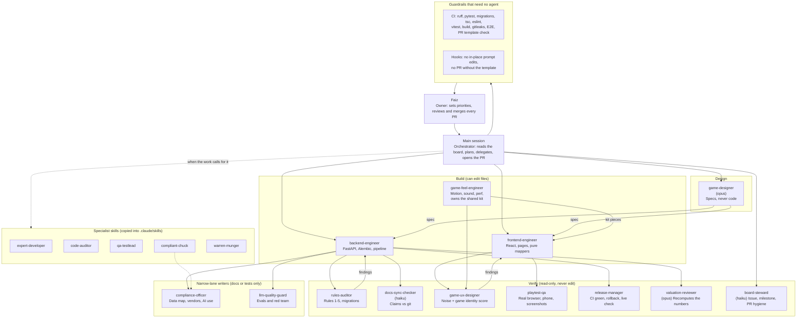

# Aladdin team: who does what, and how they fit together (2026-11-17)

Status: **written, not merged** (PR for issue #444). Mirrors the GitHub wiki page "Team Org Chart". Sources: `.claude/` in this repo at `main` `de9cdde`, `CLAUDE.md`, `docs/ops/claude-setup-assessment-2026-10-09.md`, `docs/ops/agentic-coding-audit-2026-11-01.md`, `docs/ops/pr-guardrails-2026-11-15.md`, the board's open issues, and the account skill list. Nothing here was run; it describes files and rules as written.

## What a "team member" is here (plain words)

Each team member is a role written down once, so it behaves the same way every session. A role has a job, a short list of tools it may use, and a rule for when it runs. Some roles **build** (they may edit files). Some roles only **check** (they may read, never edit). The point of the split: whoever builds something never marks their own homework.

There are three kinds of member:

- **Repo agents** (`.claude/agents/`): 13 roles that live in this repo, so every session and every cloud run sees the same ones (8 original, 5 added for issue #444).
- **Repo skills** (`.claude/skills/`): 4 game method guides the agents load, plus 5 specialist personas copied from Faiz's account on 2026-11-17 (`expert-developer`, `code-auditor`, `qa-testlead`, `warren-munger`, `compliant-chuck`).
- **Account-only skills**: `cwo-economics-analyst` stays in Faiz's account. It is the Changing World Order app's persona; `valuation-reviewer` covers Aladdin's numbers instead.

## Org chart

## The team, one by one

### Repo agents

| Role | Kind | Model | Job in one line | Runs when |
|---|---|---|---|---|
| [`game-designer`](https://github.com/frmingest/Aladdin/blob/main/.claude/agents/game-designer.md) | Design | opus | Writes the spec: player verb, the real fact it shows, unknown-data behaviour, and a "visual verb + scene" line. Rejects anything that rewards trading, streaks or speed. | Before building a game feature; in `/game-ideas` |
| [`backend-engineer`](https://github.com/frmingest/Aladdin/blob/main/.claude/agents/backend-engineer.md) | Builds | sonnet | FastAPI, SQLAlchemy, Alembic, pytest, the LLM pipeline. All money maths is plain tested code; a changed prompt is a new version file. | Any backend, migration, prompt or schema change |
| [`frontend-engineer`](https://github.com/frmingest/Aladdin/blob/main/.claude/agents/frontend-engineer.md) | Builds | sonnet | React/Vite pages. Mapping logic lives in pure tested functions; components only draw. Builds game pages from the shared kit, with a Plain view and game-voice text. | Any frontend or game-page change |
| [`game-feel-engineer`](https://github.com/frmingest/Aladdin/blob/main/.claude/agents/game-feel-engineer.md) | Builds | sonnet | Motion, SVG/CSS effects, sound, frame-rate budgets. Owns the shared page-scene kit so pages do not inline one-off art or colours. | Animation, audio, perf, or a missing kit piece |
| [`rules-auditor`](https://github.com/frmingest/Aladdin/blob/main/.claude/agents/rules-auditor.md) | Checks | sonnet | Checks the five non-negotiable rules (maths in code, evidence IDs, versioned prompts, blind pass, untrusted documents), migrations, and `confirm=true` on destructive endpoints. Gives a fix plan with code. | Every backend, prompt or schema change; before every PR |
| [`docs-sync-checker`](https://github.com/frmingest/Aladdin/blob/main/.claude/agents/docs-sync-checker.md) | Checks | haiku | Confirms every "built / committed / merged" claim against git and the real files; checks the docs mirror. | Before a PR; at session start when a doc claims something exists |
| [`game-ux-designer`](https://github.com/frmingest/Aladdin/blob/main/.claude/agents/game-ux-designer.md) | Checks | sonnet | Two lanes: noise and access (one idea once, colour-blind safe, word budgets) and Game Identity (score 0 to 3; below 2 on a new or changed page blocks it). Also reviews game-voice wording. | Every frontend change |
| [`playtest-qa`](https://github.com/frmingest/Aladdin/blob/main/.claude/agents/playtest-qa.md) | Checks | sonnet | Opens the app in a real browser on demo data: desktop and phone screenshots, reduced motion, keyboard pass, console errors, frame-rate sample. Says plainly what it did not see. | After any game UI change; before a PR |
| [`release-manager`](https://github.com/frmingest/Aladdin/blob/main/.claude/agents/release-manager.md) | Checks | sonnet | Is it safe to reach production: every CI job green, migration additive with a rollback, new env vars named, branch protection reported, what was and was not checked live. Never merges. | CI, Docker or migration changes; before Faiz merges |
| [`valuation-reviewer`](https://github.com/frmingest/Aladdin/blob/main/.claude/agents/valuation-reviewer.md) | Checks | opus | Recomputes valuation, DCF, multiples and risk figures by a second route and checks every sentence about what a number does. | Valuation or risk-maths changes; before a doc says what a number does |
| [`board-steward`](https://github.com/frmingest/Aladdin/blob/main/.claude/agents/board-steward.md) | Checks | haiku | Issue first, milestone and labels true, no dead stacked-PR merges, "done" only when merged. Reports; never edits the board. | Every PR, last |
| [`compliance-officer`](https://github.com/frmingest/Aladdin/blob/main/.claude/agents/compliance-officer.md) | Checks + writes docs | sonnet | Will keep the data map and vendor register in `docs/ops/compliance/` (created on its first run); reviews GDPR, EU AI Act and DORA exposure; separate section for the enterprise copy. | New dependency, provider, LLM client, or stored-data change |
| [`llm-quality-guard`](https://github.com/frmingest/Aladdin/blob/main/.claude/agents/llm-quality-guard.md) | Checks + writes tests | sonnet | Prompt-version diffs, golden cases, hostile-document red team (Rule 5), blind-pass test (Rule 4). Never edits prompts. | Prompt, schema or evidence-packet changes |

### Repo skills (methods the agents load)

| Skill | Used by | What it teaches |
|---|---|---|
| [`game-design-reward-knowing`](https://github.com/frmingest/Aladdin/blob/main/.claude/skills/game-design-reward-knowing/SKILL.md) | game-designer | Reward understanding (fog lifts, scrolls read, reviews written), never trading. No streaks, timers, loot or leaderboards. |
| [`game-visual-identity`](https://github.com/frmingest/Aladdin/blob/main/.claude/skills/game-visual-identity/SKILL.md) | designer, frontend, feel, UX | How a page becomes visibly a game: scene header, kit pieces, one real fact drawn, Plain view. |
| [`game-feel-and-performance`](https://github.com/frmingest/Aladdin/blob/main/.claude/skills/game-feel-and-performance/SKILL.md) | game-feel-engineer | Motion that costs little and never lies: compositor-only animation, capped loops, pause when hidden. |
| [`game-ux-onboarding-accessibility`](https://github.com/frmingest/Aladdin/blob/main/.claude/skills/game-ux-onboarding-accessibility/SKILL.md) | game-ux-designer | Tap count first, then first 10 seconds, hierarchy, colour-blind safety, reduced motion, keyboard, phone. |

### Commands (one-line ways to run the team)

| Command | What it runs |
|---|---|
| [`/ship-pr`](https://github.com/frmingest/Aladdin/blob/main/.claude/commands/ship-pr.md) | CI-equivalent checks, the reviewers the change needs, then the PR with the filled-in template. The only allowed way to open a PR. |
| [`/game-review`](https://github.com/frmingest/Aladdin/blob/main/.claude/commands/game-review.md) | designer, playtest-qa, game-ux-designer, game-feel-engineer, rules-auditor, docs-sync-checker, merged into one ranked list with an identity table. |
| [`/game-ideas`](https://github.com/frmingest/Aladdin/blob/main/.claude/commands/game-ideas.md) | Sprint idea gathering where every idea carries a page and a visual verb, plus at least one "visual win". |

### Specialist skills (copied from Faiz's account into `.claude/skills/` on 2026-11-17)

The repo copy wins; it can drift from the account version. `qa-testlead` had its CWO-project section replaced by an Aladdin one; `warren-munger` had its frontmatter cleaned. `cwo-economics-analyst` was not copied (see above).

| Persona | Job (from its skill description) | Fits Aladdin as |
|---|---|---|
| `expert-developer` | Full-stack lead: builds, fixes, architects | A second pair of hands on hard backend or architecture work |
| `code-auditor` | Security review for vulnerabilities and exploits | Security check before a PR (runs before `qa-testlead`) |
| `qa-testlead` | Writes test plans and test code (pytest, Vitest, Playwright) | Test depth beyond the engineers' own tests |
| `warren-munger` | Buffett/Munger pass/fail stress test for investment ideas | Last-step sanity check on what the "Brain" concludes (used when asked; not a PR row) |
| `compliant-chuck` | Compliance officer: GDPR, EU AI Act, DORA, NIS2 | The method `compliance-officer` loads |

## How they complement each other

**1. Makers and checkers are different people.** Engineers build; four read-only verifiers check. A verifier cannot fix its own finding, so it cannot talk itself into a pass. Findings go back to the engineer; only the failed checks re-run; after 2 rounds it stops and asks Faiz.

**2. Each verifier watches a different way things have gone wrong before.**

| Verifier | The failure it exists for | Where that happened |
|---|---|---|
| `rules-auditor` | Money maths or untrusted text slipping into the LLM path | The 5 architecture rules in `CLAUDE.md` |
| `docs-sync-checker` | A doc saying "built" when nothing was written | 2026-09-26: a whole sprint documented as built with no code in the repo |
| `game-ux-designer` | Pages that are only a Card and a list; heavy copy | Identity audit of 2026-10-09 |
| `playtest-qa` | "Works" claimed without anyone seeing it | Audit of 2026-11-01: 20 game PRs said the page was not seen in a browser |
| `game-designer` | Mechanics that reward trading or daily return | Principle "reward knowing, never trading" |
| `game-feel-engineer` | Pretty effects that cost frame rate or flatter a weak fact | 3D courtyard measured at 528 draw calls against a budget of 300 (`docs/game/` discovery plan, 2026-11-02) |

**3. Design leads, build follows, verify closes.** `game-designer` writes the spec first, `frontend-engineer` and `backend-engineer` build from it, `game-feel-engineer` supplies kit pieces that both pages share, and the verifiers judge the result against the same written standards in `.claude/standards/`.

**4. Rules are enforced twice, by people and by machines.** The agents are the judgement layer. CI, the pre-commit hooks and the PR-template check are the mechanical layer, so a tired session cannot skip them. `rules-auditor` covers what machines cannot see (is a number computed by the LLM?); CI covers what agents forget (is the build green?).

**5. Specialists plug the gaps the repo roles do not cover** (security, deep test writing, macro and investing logic, compliance), without bloating the repo team to 16 roles. The 2026-10-09 assessment chose this lean setup on purpose.

## The flow of one piece of work

1. Faiz asks, or picks an item. Work starts from an issue on the GitHub Project board (no issue, no branch).
2. Main session reads the board and plans. For a game idea, `game-designer` writes the spec first.
3. `backend-engineer` and/or `frontend-engineer` build on a feature branch; `game-feel-engineer` adds any missing kit piece.
4. Verifiers run: `rules-auditor` and `docs-sync-checker` for backend or docs; `playtest-qa` and `game-ux-designer` for UI; `release-manager`, `llm-quality-guard`, `valuation-reviewer` and `compliance-officer` when the change touches what each guards; `board-steward` last on every PR.
5. Findings go back to the engineer; only failed checks re-run (max 2 rounds).
6. `/ship-pr` runs the CI-equivalent checks, fills the PR template (every reviewer row answered), opens the PR.
7. CI runs. Faiz reviews and merges; a merge to `main` is a production deploy.

## Known limits today (so nobody over-trusts the chart)

- Verifiers are advisory. Nothing in GitHub forces a merge to wait for them or for CI: the branches API reported `protected: false` for `main` on 2026-11-17 (issue #377 is open), and the 2026-11-01 audit found 35 of 97 PRs merged before CI finished.
- The `no-issue` label now skips the template check and the linked-issue check only for a docs-only PR (decided 2026-11-17); on any other file it is ignored.
- The PR-template check proves a reviewer row is filled in, not that the reviewer ran. A row marked `yes` that never ran is a lie only the rules can catch.
- The five specialist skills in `.claude/skills/` are copies; they can drift from the account versions Faiz edits, and nothing syncs them.
- The agent definitions began as drafts on 2026-10-09 (`docs/ops/claude-setup-assessment-2026-10-09.md`); model choices and tool lists are still worth revisiting after real use.

## Gap roles added on 2026-11-17 (issue #444)

What each closes, and the evidence it came from. The PR-template checker now requires a row for each, and refuses `skipped` for four of them when the matching paths change (`release-manager`: CI, Docker, Alembic; `llm-quality-guard`: prompts, analysis schema; `valuation-reviewer`: valuation and risk-maths code; `compliance-officer`: requirements, `package.json`, providers, LLM clients).

| Role | Gap it closes | Evidence |
|---|---|---|
| `compliance-officer` | Nobody owned GDPR, EU AI Act, DORA or data-processor questions, although the app holds real holdings and documents and sends excerpts to Gemini and Mistral; also needed for the enterprise rebuild | No compliance, DPIA or processor-register doc found in `docs/` |
| `release-manager` | The path from merge to production was unguarded and unwatched | Issues #377, #406, #437; audit 2026-11-01 finding 1 |
| `llm-quality-guard` | New prompt versions were never compared with old ones; Rule 5 had no adversarial suite | One golden test (text encoding) found in `backend/tests` |
| `valuation-reviewer` | `rules-auditor` checks where maths lives, not that it is right | 2026-11-15 Toll Gate claim (`docs/ops/pr-guardrails-2026-11-15.md`) |
| `board-steward` | Board hygiene was policed by memory | Audit 2026-11-01 findings 5 and 6 |

Also done: five specialist skills copied into the repo; `.claude/standards/game3d-standard.md` written (approved by Faiz on 2026-11-17; the draw-call count in the e2e report is issue #448); `/ship-pr`, the PR template, the checker and `CLAUDE.md` know the new rows.

## Still open (nothing here was run)

- None of the five new agents has run on real work yet. Their prompts are drafts: tune model choice and tool lists after the first use.
- `compliance-officer` has no registers to maintain yet; its first run should create `docs/ops/compliance/data-map.md` and `vendor-register.md` from the code.
- `llm-quality-guard` has no golden set yet; `backend/tests/evals/` does not exist until its first run.
- Branch protection on `main` is still Faiz's to set (#377); `release-manager` reports it but cannot change it.
- The checker change takes effect in CI only after this PR merges, because CI runs the checker from the base branch.
